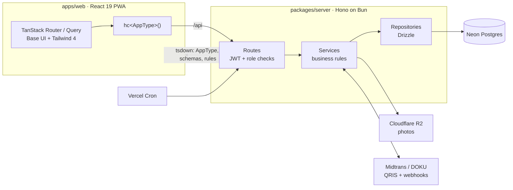

# Fresclean


The production system for **Fresclean**, a multi-store shop in Indonesia that cleans, restores and repairs footwear, bags, hats and luggage. Staff run the counter, the workshop and the books on it every day; Customers track their shoes on it without logging in.

## What it does

- **POS**: Orders, Campaigns and Vouchers, payment by cash, transfer or QRIS, receipts printed over Bluetooth
- **Workshop**: a per-Store Queue, each Item's Services moving `queued → processing → waiting_qc → ready_for_pickup`, photos, quality checks, Complaints and Rework
- **Pickup**: a WhatsApp notice, a six-digit Pickup code, a photo at handover
- **Running the shop**: a live Counter, a Day close, nine report panels, geofenced attendance
- **Track page**: Customers see each Item's progress and pay by QRIS

The unit of work is a single **Item** (one pair of shoes), not a load of laundry. [`GLOSSARY.md`](GLOSSARY.md) fixes the meaning of every term the code and UI use.

## Architecture



A Turborepo monorepo with two packages: [`packages/server`](packages/server) (`@fresclean/api`) and [`apps/web`](apps/web) (`@fresclean/web`). Both deploy to Vercel in Singapore (`sin1`), next to the Neon database.

## Engineering decisions

Each one names the problem, the choice, and where it lives. The business rules behind them are recorded as ADRs in [`docs/adr/`](docs/adr) (28 so far).

### 1. End-to-end types without codegen

**Problem:** the web app and API drift apart when request and response shapes are written twice.
**Choice:** the server exports its Hono router type; `tsdown` bundles it with the Zod schemas into the workspace package, and the web app calls the API through a typed `hc<AppType>()` client. Logic both sides must agree on (which statuses are still in the workshop, which Items can be collected) ships as a separate zod-free `rules` export.

- [`packages/server/src/index.ts:35`](packages/server/src/index.ts#L35): `AppType`
- [`packages/server/src/rpc.ts`](packages/server/src/rpc.ts): the client the web app imports
- [`packages/server/src/schema/rules.ts`](packages/server/src/schema/rules.ts): rules shared with the browser

### 2. One writer for every status change

**Problem:** an Item's status drives the Queue, the Counter, the Track page and the reports. A handler that writes a status column directly skips the checks and leaves no history.
**Choice:** only the Order Status Machine writes statuses. It validates the transition, refuses to start work without a "before" photo (ADR-0012), writes the status log, and rolls the Item statuses up into the Order's. Pickups and refunds have their own entry points in the same module.

- [`packages/server/src/modules/orders/order-status-machine.ts:365`](packages/server/src/modules/orders/order-status-machine.ts#L365): `transitionOrderService`
- [`order-status-machine.ts:306`](packages/server/src/modules/orders/order-status-machine.ts#L306): the photo gate

### 3. Jakarta days on UTC columns

**Problem:** the shop lives in Asia/Jakarta (UTC+7); the columns hold UTC wall time in a plain `timestamp`. A single `AT TIME ZONE 'Asia/Jakarta'` reads that as local time and lands 14 hours off, moving afternoon Orders onto the wrong day.
**Choice:** every report bucket goes through one SQL helper that names UTC first, with a JavaScript twin so chart labels match Postgres' buckets exactly (ADR-0002).

- [`packages/server/src/modules/reports/report-range.util.ts:82`](packages/server/src/modules/reports/report-range.util.ts#L82): `jakartaBucketExpr`
- [`packages/server/src/utils/date.ts`](packages/server/src/utils/date.ts): day boundaries in application code

### 4. A swappable payment gateway

**Problem:** Indonesian gateways differ in API, signature scheme and reliability, and the shop wanted to be able to switch.
**Choice:** Midtrans and DOKU sit behind one `PaymentGateway` interface, picked by an environment variable. Webhooks verify signatures over the raw request bytes. Notices do go missing, so a nightly job asks the gateway once about every QRIS that ended unsettled. For local work a mock gateway serves a fake payment page whose buttons send real signed notices (ADR-0028).

- [`packages/server/src/modules/payments/gateways/types.ts`](packages/server/src/modules/payments/gateways/types.ts): the interface
- [`packages/server/src/modules/payments/gateways/index.ts`](packages/server/src/modules/payments/gateways/index.ts): selection, and the mock wrapper
- [`packages/server/src/modules/payments/payment-charge.service.ts:481`](packages/server/src/modules/payments/payment-charge.service.ts#L481): `settleEndedCharges`
- [`packages/server/src/routes/webhooks.ts`](packages/server/src/routes/webhooks.ts): signature check on raw bytes

### 5. Hosting shaped by the bill

**Problem:** a counter app is busy for a few seconds at a time, spread across the whole day.
**Choice:** the API is a plain Bun function, not a container: a container bills its memory until five quiet minutes pass, which at the counter's pace meant every open hour. Because the function scales to zero, rate limiting lives in the Vercel firewall, not in memory where it would reset. The region is pinned to `sin1`; without it Vercel defaults to the US and every query crosses the Pacific.

- [`vercel.json`](vercel.json): region, services, cron schedules

### 6. Photos on R2, swept nightly

**Problem:** every Item is photographed at drop-off, before work and at pickup. Staff sometimes upload a batch and then abandon the Order, leaving files nothing points at.
**Choice:** the browser uploads straight to Cloudflare R2 with a presigned URL; photos are served from a custom domain and cached for a year as `immutable`, since a key's photo never changes. Keys carry their environment (`dev/` or `prod/`), and a nightly sweep deletes files no Order points at, skipping anything under 24 hours old.

- [`packages/server/src/utils/s3.ts`](packages/server/src/utils/s3.ts): presigning and the environment prefix
- [`packages/server/src/modules/orders/order-photo-sweep.service.ts`](packages/server/src/modules/orders/order-photo-sweep.service.ts): the sweep

### 7. Migrations as an append-only ledger

**Problem:** `drizzle-kit push` changes a database without leaving a record, so dev, prod and the schema file drift apart.
**Choice:** every change is a generated, committed migration, applied in order to every environment and never edited after it runs. A read-only drift check runs before and after each prod migration, and migrations go to prod before the code that needs them merges.

- [`packages/server/drizzle/`](packages/server/drizzle): the ledger
- [`packages/server/AGENTS.md`](packages/server/AGENTS.md): the workflow and the prod checklist

### 8. Integration tests against real Postgres in memory

**Problem:** mocked repositories can't catch a wrong SQL rollup or a bad join.
**Choice:** integration suites spin up PGlite (Postgres compiled to WASM), apply the real migration ledger, and swap it in for the database module. Tests run with `--isolate` so each file's module mocks stay in that file.

- [`packages/server/src/test-support/pglite.ts`](packages/server/src/test-support/pglite.ts): the test database
- [`packages/server/src/modules/payments/payment-charge.service.integration.test.ts`](packages/server/src/modules/payments/payment-charge.service.integration.test.ts): an example suite

### 9. Built for a phone on a shop floor

**Problem:** staff work on tablets and phones, often mid-conversation with a Customer, and a page reload or a print dialog costs them the moment.
**Choice:**
- An installable PWA whose new builds take over without reloading the page, so a deploy never wipes a cashier's half-built Order.
- Receipts print over Web Bluetooth as raw ESC/POS to a thermal printer, with no print dialog and no driver.
- Clock-in is refused beyond 3 km of the Store, giving the phone's own accuracy the benefit of the doubt, and no location is stored (ADR-0020).

- [`apps/web/vite.config.ts`](apps/web/vite.config.ts): service worker in `autoUpdate` mode
- [`apps/web/src/features/printing/web-bluetooth-transport.ts`](apps/web/src/features/printing/web-bluetooth-transport.ts) and [`escpos.ts`](apps/web/src/features/printing/escpos.ts): receipt printing
- [`packages/server/src/modules/shifts/shift.service.ts:39`](packages/server/src/modules/shifts/shift.service.ts#L39): the clock-in radius check

## Quality gates

| Check | Command |
| --- | --- |
| Tests (115 files, 19 against PGlite) | `bun run test` |
| Types | `bun run type-check` |
| Lint and format (Ultracite / Biome) | `bun x ultracite check` |

A change is done when all three pass from the repo root. Husky runs `ultracite fix` on staged files before each commit.

## Running it

```sh
bun install        # Install all workspace dependencies
bun run dev        # Build API types, then start server (:8000) + web (:5173)
```

The server reads its configuration from `packages/server/.env`; [`packages/server/.env.example`](packages/server/.env.example) lists every variable, and [`packages/server/README.md`](packages/server/README.md) explains each one.

## Docs

- [`AGENTS.md`](AGENTS.md) (`CLAUDE.md` symlinks to it): repo-wide guidance, deployment, scheduled jobs
- [`GLOSSARY.md`](GLOSSARY.md): domain glossary
- [`docs/adr/`](docs/adr): architecture decision records
- Package READMEs: [`packages/server`](packages/server/README.md), [`apps/web`](apps/web/README.md)
