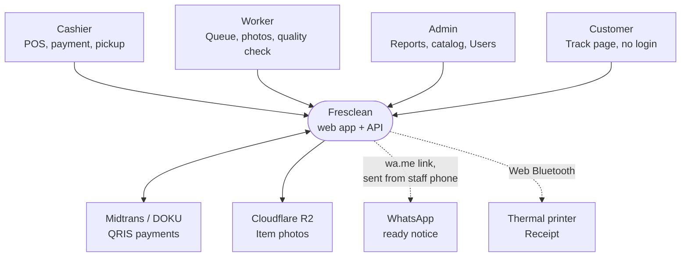
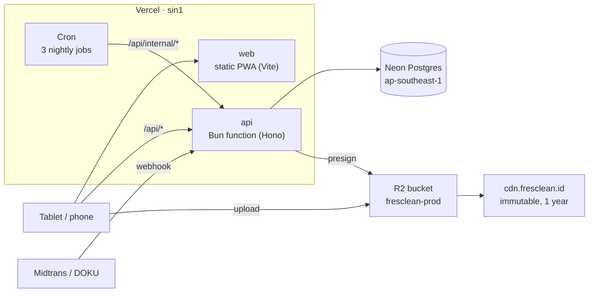
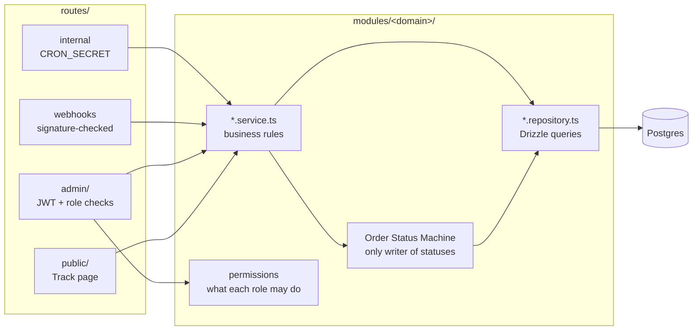
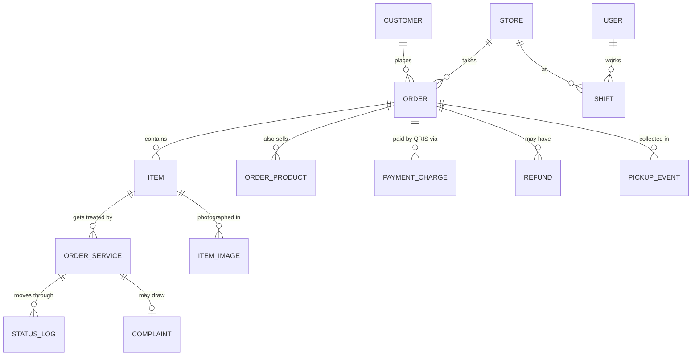
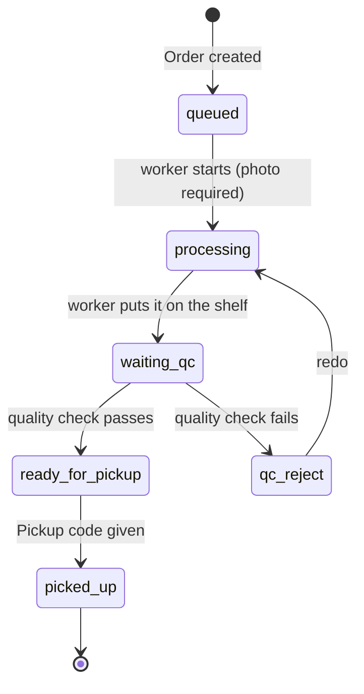
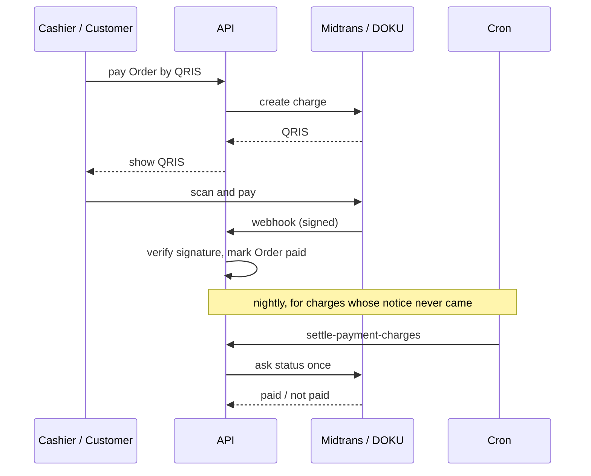
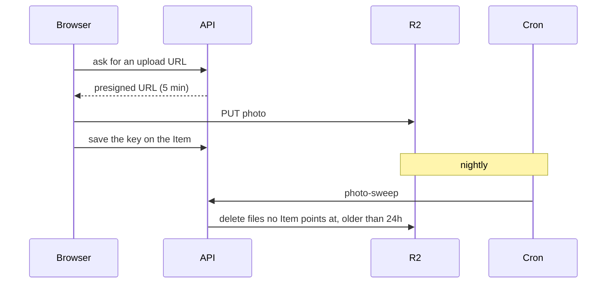

# Fresclean


The production system for **Fresclean**, a multi-store shop in Indonesia that cleans, restores and repairs footwear, bags, hats and luggage. Staff run the counter, the workshop and the books on it every day; Customers track their shoes on it without logging in.

The unit of work is a single **Item** (one pair of shoes), not a load of laundry. [`GLOSSARY.md`](GLOSSARY.md) fixes the meaning of every term below, and [`docs/adr/`](docs/adr) records the business rules behind them.

## 1. System context

Who uses the system, and what it talks to.



| Actor | Does |
| --- | --- |
| Cashier | Builds Orders in the POS, takes payment by cash, transfer or QRIS, prints the Receipt, hands Items over against the Pickup code |
| Worker | Works the Queue, photographs Items, moves each Service through its statuses, checks other workers' Items |
| Admin | Reports, the catalog (Stores, Services, Products, Campaigns), Users and their roles, Shift edits |
| Customer | Opens the Track page with a phone number and Pickup code, sees each Item's progress, pays by QRIS |

## 2. Deployment

Everything runs in Singapore, close to the shop.



- **One Vercel project, two services**: the web app is static files; the API is a plain Bun function that scales to zero. A container was dropped because it billed until five quiet minutes passed, which at the counter's pace meant every open hour.
- **Region pinned** in [`vercel.json`](vercel.json): without `"regions": ["sin1"]` Vercel runs the function in the US and every query crosses the Pacific to Neon.
- **Rate limits live in the Vercel firewall**, not in memory, since a function that scales to zero would reset its counters.
- **Cron jobs** (schedules in UTC): a sweep of abandoned photos, closing Shifts nobody clocked out of, and settling QRIS payments whose notice never arrived. Each is safe to skip or run twice.
- **One environment per database**: dev and prod each have their own Neon database, R2 bucket and bucket token; photo keys carry a `dev/` or `prod/` prefix too.

## 3. Inside the server



- **Three layers per domain** in [`packages/server/src/modules/`](packages/server/src/modules): routes stay thin, services hold the rules (`createOrder`), repositories hold the SQL (`insertOrder`).
- **One writer for statuses**: [`order-status-machine.ts`](packages/server/src/modules/orders/order-status-machine.ts) is the only code that changes an Item's or Order's status. It refuses invalid transitions, refuses to start work without a "before" photo, writes the status log, and rolls Item statuses up into the Order's.
- **Permissions** in [`permissions.ts`](packages/server/src/modules/permissions/permissions.ts): one `assertCan…` per action across four roles (admin, cashier, worker, courier).
- **Payment gateways** sit behind one interface in [`modules/payments/gateways/`](packages/server/src/modules/payments/gateways), chosen by `PAYMENT_GATEWAY`. A mock gateway stands in for local development.
- **Jakarta time**: columns hold UTC; every report day is bucketed in Asia/Jakarta through [`jakartaBucketExpr`](packages/server/src/modules/reports/report-range.util.ts).

### Shared with the web app

The server package builds three exports with `tsdown`, so the web app gets typed API calls with no code generation:

```
packages/server ──tsdown──► @fresclean/api/rpc     hc<AppType>() typed client
                            @fresclean/api/schema  Zod schemas for forms
                            @fresclean/api/rules   logic both sides run (no Zod, no DB)
                                   │
                                   ▼
                            apps/web
```

## 4. Data model

The core of the schema in [`packages/server/src/db/schema.ts`](packages/server/src/db/schema.ts); catalog, Campaign and log tables left out.



- An **Order** holds **Items**; each Item gets one or more **OrderServices** (clean, repaint, repair), and each OrderService has its own status.
- A **Complaint** hangs off the OrderService it is about. Putting it right adds a free **Rework line**: another OrderService on the same Order.
- Every status change is a row in `order_service_status_logs`, which is what the Turnaround and Quality reports are built from.

## 5. Key flows

### Item lifecycle



Not drawn: any open status can also go to `cancelled` or `refunded`, and a picked-up Item can still be refunded. The Order's own status is rolled up from its Items, so the Counter and the Track page read one value.

### QRIS payment



A duplicate notice can't book the money twice: the webhook, the nightly check and the cashier's "Mark as paid" all go through the same guarded update.

### Photo upload



Photos go straight from the phone to R2, so the API never carries the file.

## Quality gates

| Check | Command |
| --- | --- |
| Tests (115 files, 19 against an in-memory Postgres via PGlite) | `bun run test` |
| Types | `bun run type-check` |
| Lint and format (Ultracite / Biome) | `bun x ultracite check` |

A change is done when all three pass from the repo root. Husky runs `ultracite fix` on staged files before each commit.

## Running it

```sh
bun install        # Install all workspace dependencies
bun run dev        # Build API types, then start server (:8000) + web (:5173)
```

The server reads its configuration from `packages/server/.env`; [`packages/server/.env.example`](packages/server/.env.example) lists every variable, and [`packages/server/README.md`](packages/server/README.md) explains each one.

## Docs

- [`AGENTS.md`](AGENTS.md) (`CLAUDE.md` symlinks to it): repo-wide guidance, deployment, scheduled jobs
- [`GLOSSARY.md`](GLOSSARY.md): domain glossary
- [`docs/adr/`](docs/adr): architecture decision records
- Package READMEs: [`packages/server`](packages/server/README.md), [`apps/web`](apps/web/README.md)
